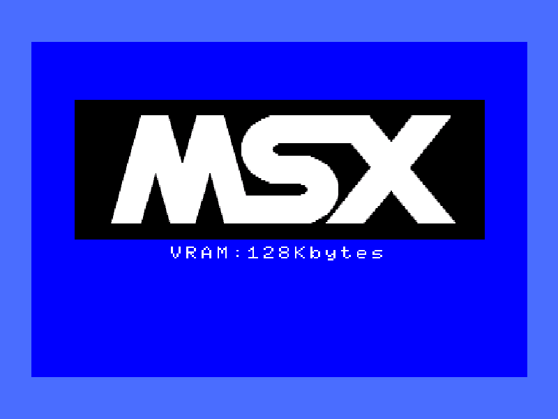
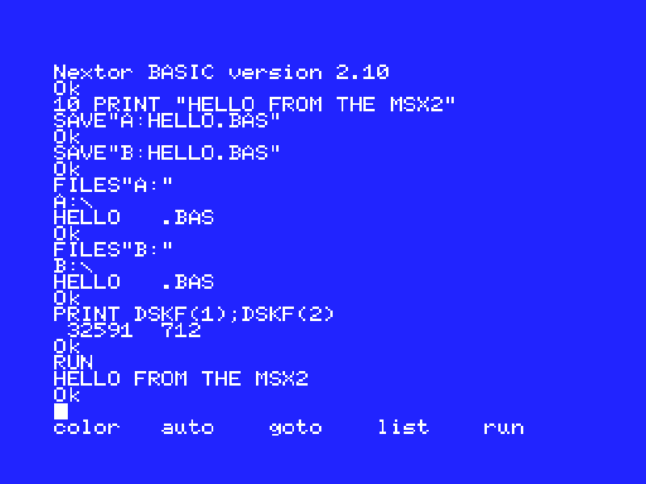
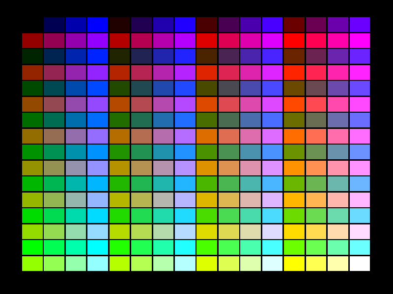
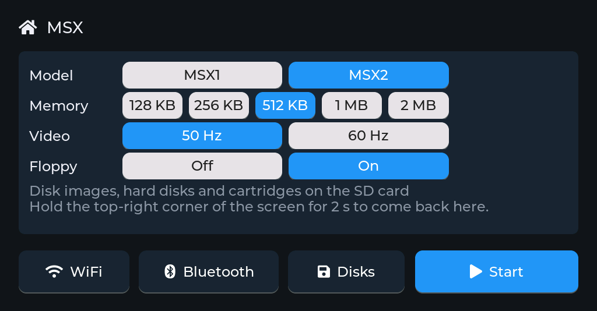
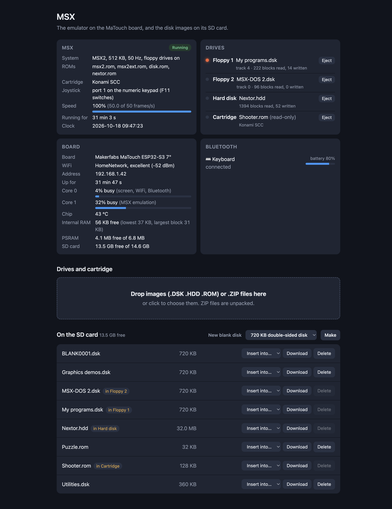
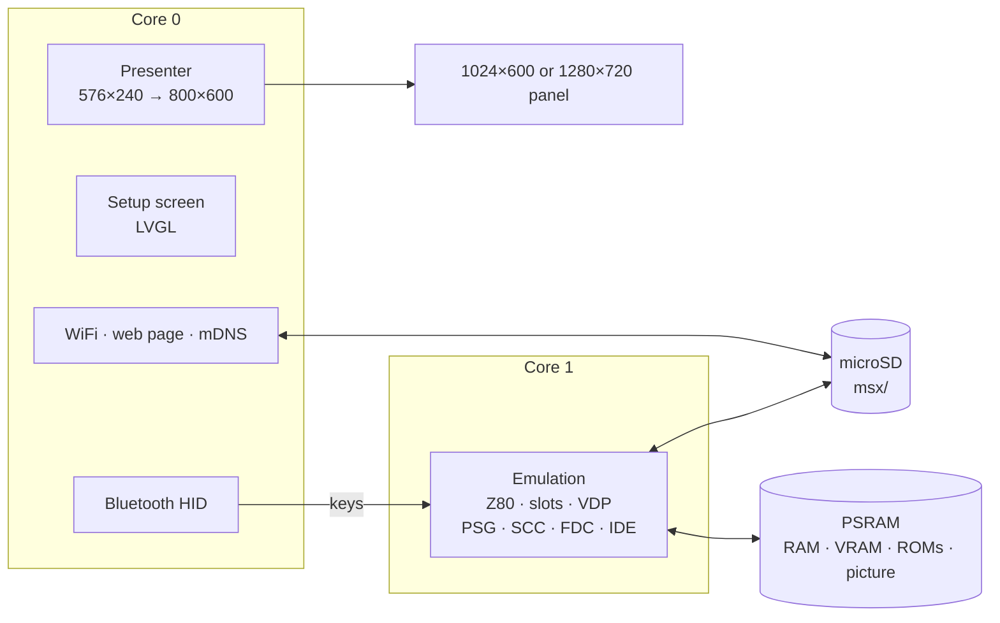

<h1 align="center">esp32msx</h1>

<p align="center">
  <b>An MSX1 or MSX2 on a 7-inch ESP32-S3 touch-screen board or an M5Stack Tab5.</b><br>
  Z80 with the MSX's wait states, TMS9918A and V9938 with all their modes and commands, AY-3-8910 and SCC sound, floppy drives, a Nextor hard disk, ROM cartridges, Bluetooth keyboard.
</p>

<p align="center">
  
  
  
  
  
  
</p>

<p align="center">
  
  
  <br>
  
  
  <br>
  <sub>The MSX2 starting; Nextor BASIC with a hard disk and a floppy; SCREEN 8's 256 colours;
  the setup screen. As on the MaTouch's panel, border included.</sub>
</p>

esp32msx turns the Makerfabs MaTouch ESP32-S3 Parallel TFT with Touch 7", or an
M5Stack Tab5, into an MSX1 or MSX2. The picture, border included, fills the
panel's height; a Bluetooth keyboard works the MSX, and disk images,
hard disks and cartridges come from the microSD card. A setup screen on the
touch panel, and a web page on your network, handle everything else.

It's the sibling of [esp32ste](https://github.com/rlucencic/esp32ste) (Atari
STE), [esp32mac](https://github.com/rlucencic/esp32mac) (Macintosh Plus,
SE, Classic), [esp32cpc](https://github.com/rlucencic/esp32cpc) (Amstrad
CPC), [esp32zx](https://github.com/rlucencic/esp32zx) (ZX Spectrum),
[esp32cbm](https://github.com/rlucencic/esp32cbm) (Commodore 64 and 128),
[esp32xl](https://github.com/rlucencic/esp32xl) (Atari 800XL and 130XE) and
[esp32gs](https://github.com/rlucencic/esp32gs) (Apple IIGS); all are built on the shared runtime
[esp32emu](https://github.com/rlucencic/esp32emu), which also holds the Z80
core this one shares with the Amstrad and the Spectrum.

## Features

**The machines**
- **MSX1** (64 KB, TMS9918A, or TMS9929A at 50 Hz) and **MSX2** (a memory
  mapper of 128 KB to 2 MB, on the Tab5 to 4 MB; V9938 with 128 KB of VRAM,
  RP5C01 clock), chosen on the setup screen with **50 or 60 Hz** video
- **Z80** at 3.58 MHz on the shared core, with the wait state the MSX engine
  adds to every M1 cycle
- **Slots and subslots** as an MSX lays them out: BIOS and BASIC, the
  cartridge, the memory mapper, the MSX2's SUB-ROM, the disk ROM, Nextor
- **TMS9918A / V9938**: text 40 and 80 columns (with blink), the graphic
  modes G1 to G7, multicolour, sprite modes 1 and 2 (eight a line, a colour
  per line), the 512-colour palette, vertical scroll, line interrupts and all
  the V9938's commands (lines, fills, block moves, logical operations)
- **Sound**: the AY-3-8910's three channels and noise, the key click, and
  Konami's SCC in SCC cartridges
- **Keyboard** by position (international layout), **joystick** on the
  numeric keypad or the cursor keys

**Drives**
- **Two floppy drives** behind a WD2793, as Philips built the disk interface:
  `.dsk` images (720 KB and 360 KB), read and written in place, new
  formatted disks on request. **Floppy Off** leaves the disk interface out,
  as on an MSX without drives: BASIC starts at once and, without a hard
  disk, has 28815 bytes free instead of 23430 (the disk ROM keeps its work
  area at the top of RAM), which some cassette-era programs need. A Nextor
  hard disk works either way
- **A hard disk** on a Sunrise IDE interface with **Nextor**: a raw image of
  any size, read and written in place; new ones come with a FAT16 partition
  (32 or 128 MB). With a hard disk in, Nextor starts first: the hard disk is
  A: and the floppies B: and C:, as on an MSX with a Nextor cartridge
- **ROM cartridges**: plain ROMs up to 64 KB and MegaROMs (ASCII 8, ASCII
  16, Konami, Konami SCC), the mapper found from the code

**Around it**
- **Setup screen** before the MSX starts, and any time while it runs (hold
  the top-right corner for 2 seconds): WiFi, Bluetooth pairing, the model,
  memory, video, the floppy drives, the drives and cartridge, reset
- **Bluetooth keyboard** (BLE HID)
- **Web page** at `http://msx.local`: drop disk images, hard disks,
  cartridges or `.ZIP` files onto it, put them into drives, eject, make
  blank disks, and watch the machine, drives, board and Bluetooth devices live
- **Sound** on the board's speaker (on the Tab5 by default, on the MaTouch
  optional, `menuconfig`)

<p align="center">
  
</p>

## Hardware

| | Makerfabs MaTouch ESP32-S3 7" | M5Stack Tab5 |
|---|---|---|
| Chip | ESP32-S3-WROOM-1-N16R8: 16 MB flash, 8 MB octal PSRAM | ESP32-P4 (RISC-V, 360 MHz): 16 MB flash, 32 MB PSRAM; an ESP32-C6 for WiFi and Bluetooth |
| Screen | 7" 1024×600 RGB, GT911 capacitive touch | 5" 1280×720 MIPI-DSI, capacitive touch, held landscape |
| Storage | microSD card (FAT32 or exFAT) | microSD card (FAT32 or exFAT) |
| Input | any BLE keyboard | any BLE keyboard, or the Tab5 Keyboard |
| Sound | a speaker on the MAX98357A output (optional, `menuconfig`) | the built-in speaker (ES8388) |

The picture is 576×240: the 512 pixels of the V9938's hires modes (the
256-pixel modes drawn twice) with a border of 32 each side, and 192 or 212
lines with the border above and below. On the MaTouch it's 800×600, on the
Tab5 960×720.

## Getting started

### 1. What you need

- [ESP-IDF](https://github.com/espressif/esp-idf) v5.5 (developed with v5.5.4)
- [esp32emu](https://github.com/rlucencic/esp32emu), checked out next to this project (`../esp32emu`)
- The MSX ROM images in `roms/` (see [roms/README.md](roms/README.md)):
  the MSX1 or MSX2 BIOS, the MSX2 SUB-ROM, and if you like the disk ROM and
  Nextor
- A microSD card, FAT32 or exFAT

### 2. Build and flash

```sh
git clone https://github.com/rlucencic/esp32emu.git     # the shared runtime, next to it
git clone https://github.com/rlucencic/esp32msx.git && cd esp32msx
idf.py build
idf.py -p /dev/cu.usbmodem… flash      # app and the ROM images

# or for the M5Stack Tab5 (its own build folder and settings):
idf.py -B build-tab5 -DIDF_TARGET=esp32p4 -DSDKCONFIG=build-tab5/sdkconfig build
idf.py -B build-tab5 -DIDF_TARGET=esp32p4 -DSDKCONFIG=build-tab5/sdkconfig -p /dev/cu.usbmodem… flash
```

Later updates only need `idf.py -p … app-flash`. Instead of flashing the
ROMs, you can also copy them into a `roms` folder on the SD card.

### 3. First start

1. The board starts on the **setup screen**. Tap **WiFi** to join your
   network: the web page becomes reachable.
2. Tap **Bluetooth** to pair a keyboard.
3. Choose the **model**, the MSX2's **memory**, the **video** frequency and
   the **floppy** drives, then tap **Start**: MSX BASIC.
4. Open `http://msx.local`, drop a disk image or a cartridge onto the page,
   then **Insert into…**: a floppy is there at once, a cartridge or a hard
   disk starts the MSX again with it.

## Using it

| To | Do |
|---|---|
| Get back to the setup screen | Hold the top-right corner of the screen for 2 s |
| Change the model, memory, video or floppy drives | On the setup screen; **Restart** applies it |
| Play a cartridge | Insert it into **Cartridge** (setup screen's Disks page, or the web page): the MSX starts with it |
| Use a hard disk | **New** → 32 or 128 MB on the drives page or the web page, insert it into **Hard disk**: Nextor starts with it as A: (in BASIC; Nextor starts its DOS from a disk that has `NEXTOR.SYS` and `COMMAND2.COM` on it) |
| Load or save a program | `SAVE"A:NAME.BAS"`, `LOAD"A:NAME.BAS"`, `FILES` |
| Make a new floppy | **New** next to a floppy drive, or on the web page: a formatted 720 KB disk |
| Copy files from a computer | Drop them onto the web page (ZIP files are unpacked), or `curl -T game.rom http://msx.local/disks/` |

Images live in the `msx` folder on the SD card. The inserted ones are
remembered across restarts.

**Keyboard**: by position, the international MSX layout on a US keyboard:
Ctrl, Shift and Caps Lock as themselves, left Alt GRAPH, right Alt CODE,
F1-F5 as themselves and F6-F10 as SHIFT with F1-F5, Home CLS/HOME, Insert
INS, Delete DEL, End or Pause STOP, Page Up SELECT.

**Joystick**: the numeric keypad (8 4 6 2 and the diagonals, 0 or 5 trigger
A, `.` trigger B) in port 1; F11 switches it to port 2. F12 makes the cursor
keys the joystick too (Alt trigger A, AltGr trigger B).

## Configuration

`idf.py menuconfig` → **Emulator board**:

| Option | Default | |
|---|---|---|
| WiFi, setup screen | on | Time zone for the clock (POSIX TZ) |
| Start by itself | off | Countdown on the setup screen |
| Web page, network name | on, `msx` | `http://<name>.local` |
| BLE keyboard and mouse | on | |
| Sound on the speaker | off (Tab5: on) | Volume; moves the MaTouch's console to the UART port |

## How it works



- **`components/msx`**: the MSX1 and MSX2, platform independent. It also
  builds on a desktop (`components/msx/host`) for testing with scripted
  typing, keys and joystick, disks, cartridges, screenshots, sound recording
  and CPU traces.
- **`main`**: the MSX on the board: memory, ROMs, settings, keyboard map,
  joystick, drives and status.
- **[esp32emu](https://github.com/rlucencic/esp32emu)**: the board runtime
  and the Z80 core (here with its MSX memory option: eight 8 KB banks and
  the subslot register at `$FFFF`).

The Z80 sees memory through eight 8 KB banks; every change of a slot, a
subslot, a mapper segment or a cartridge bank puts the right blocks in front
of it, and blocks with registers go to their device. A frame is 313 lines
(50 Hz) or 262 (60 Hz) of 228 Z80 cycles. The video chip draws each line
once the beam has passed it, with its registers as they are then, so splits
made in a line interrupt land where they should; a frame in which nothing
visible changed isn't drawn again. Sound register writes are stamped with
their time and replayed on the speaker's own task.

## Development

```sh
make -C components/msx/host                                        # desktop build of the MSX
MSX_ROMS=roms MSX_MODEL=2 components/msx/host/build/msx_host 300 out.ppm
MSX_ROMS=roms MSX_MODEL=2 MSX_HD=nextor.hdd MSX_TEXT=1 components/msx/host/build/msx_host 600
make -C ../esp32emu/components/z80/test                            # the Z80 tests

python ../esp32emu/tools/emu_console.py /dev/cu.usbmodem… screenshot screen.png    # the MSX's screen
python ../esp32emu/tools/emu_console.py /dev/cu.usbmodem… send 'T FILES\n'        # type on the MSX
curl http://msx.local/api/status                                                  # live status as JSON
```

`CLAUDE.md` has the details: architecture, timing, the drives, debugging
options and the lessons learned along the way.

## Limitations

- Tested so far with MSX1 and MSX2 BASIC, the screen modes, sprites and the
  V9938's commands, floppies, Nextor on a hard disk, and test cartridges for
  each mapper and the SCC; **games haven't been tried yet**.
- Not tried by hand yet: a Bluetooth keyboard on the MSX, the joystick, sound
  on the speakers.
- No cassette, printer, MSX-MUSIC (FM-PAC) or MSX-AUDIO; no MSX2+ or turbo R;
  `.dsk` images only (no `.dmk`); one hard disk; cartridges in one slot.
- Floppies are quicker than a real drive: a sector is there as soon as it's
  asked for.

## Credits

- [openMSX](https://openmsx.org): the reference for the Sunrise IDE and many
  details of the machines
- [fMSX](https://fms.komkon.org/fMSX/) by Marat Fayzullin: the way to tell
  MegaROM mappers apart
- [Nextor](https://github.com/Konamiman/Nextor) by Konamiman
- [LVGL](https://lvgl.io) for the setup screen
- [ESP-IDF](https://github.com/espressif/esp-idf) and NimBLE

## Licence

[MIT](LICENSE). LVGL (MIT) and ESP-IDF (Apache 2.0) are fetched at build time
and keep their own licences.

MSX is a trademark of MSX Licensing Corporation. The ROM images are not part
of this repository.
